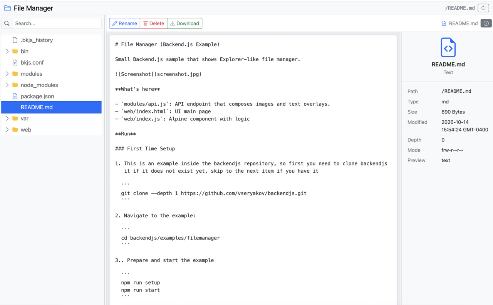

# File Manager (Backend.js Example)

Small Backend.js sample that shows Explorer-like file manager.



**What’s here**

- `modules/api.js`: API endpoints to browse filesystem or S3 using the files module
- `web/index.html`: UI main page
- `web/index.js`: Alpine component with logic

**Run**

### First Time Setup

1. This is an example inside the backendjs repository, so first you need to clone backendjs
   it if it does not exist yet, skip to the next item if you have it

  ```
  git clone --depth 1 https://github.com/vseryakov/backendjs.git
  ```

2. Navigate to the example:

  ```
  cd backendjs/examples/filemanager
  ```

3. Prepare and start the example

  1. Browse your local filessystem:
     ```
     npm run setup
     npm run start
     ```

  2. To browse S3 bucket on local laptop:
     - login into AWS CLI: `aws login`
     - run the backend with additional parameters where BUCKET is the name of your S3 bucket

       ```
       npm run start -- -app-roles s3 -files-s3-bucket BUCKET
       ```

4. Visit [http://localhost:8000](http://localhost:8000)


**Notes**

- Backend.js is pulled from GitHub (`backendjs`).
- The UI uses Bootstrap and Alpine.js
