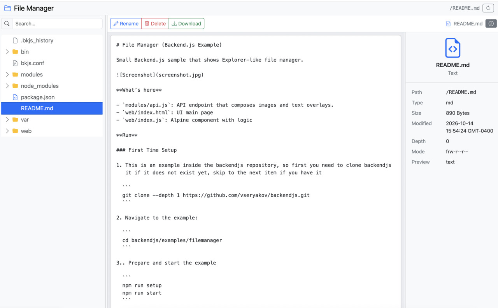

# File Manager (Backend.js Example)

Small Backend.js sample that shows Explorer-like file manager.



**What’s here**

- `modules/api.js`: API endpoints to browse filesystem using the files module
- `web/index.html`: UI main page
- `web/index.js`: Alpine component with logic

**Run**

### First Time Setup

1. This is an example inside the backendjs repository, so first you need to clone backendjs
   it if it does not exist yet, skip to the next item if you have it

  ```
  git clone --depth 1 https://github.com/vseryakov/backendjs.git
  ```

2. Navigate to the example:

  ```
  cd backendjs/examples/filemanager
  ```

3.. Prepare and start the example

  ```
  npm run setup
  npm run start
  ```

4. Visit [http://localhost:8000](http://localhost:8000)


**Notes**

- Backend.js is pulled from GitHub (`backendjs`).
- The UI uses Bootstrap and Alpine.js
